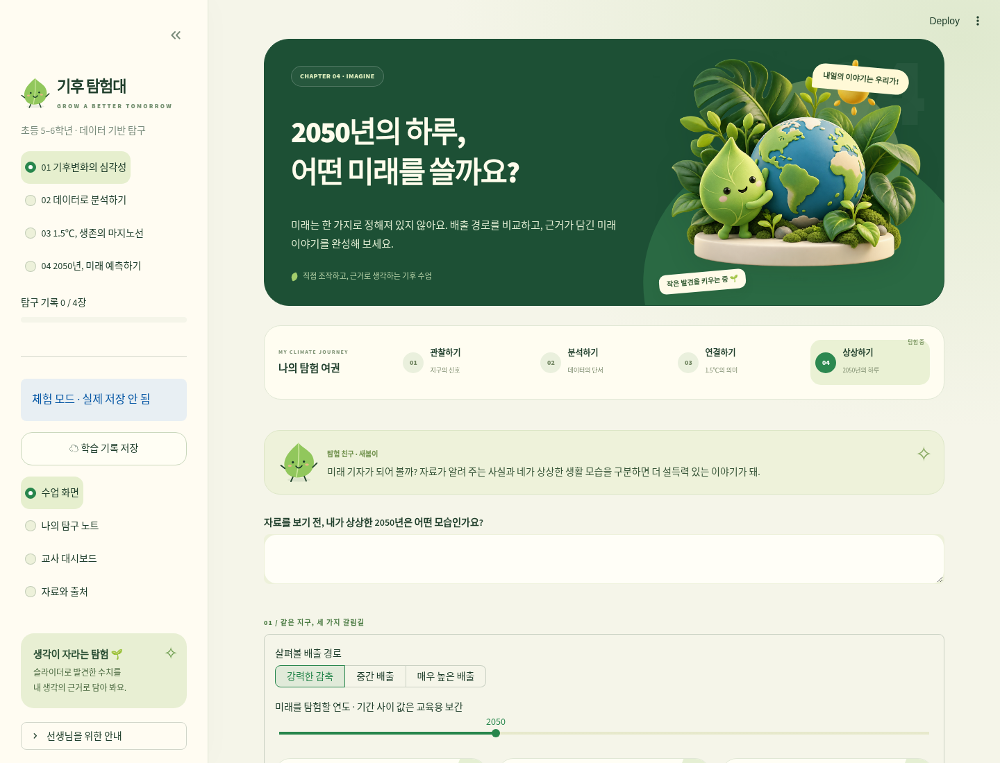

# 🌏 기후 탐험대 · Climate Explorers Lab

초등 5–6학년이 직접 슬라이더를 조작하며 배우는 **Streamlit 온라인 기후 학습지**입니다. 기후 현상 → 데이터 분석 → 1.5℃ → 2050년의 미래 글쓰기를 연결합니다.

## 실행

```bash
pip install -r requirements.txt
streamlit run streamlit_app.py
```

비밀 설정 없이도 체험할 수 있습니다. 실제 Google 로그인·학생 기록 저장에는 Google OAuth와 Firebase Firestore 설정이 필요합니다. **체험 데이터는 서버에 영구 저장되지 않습니다.**

## 주요 기능

- 입체 자연 일러스트·새싹 캐릭터·삽화 카드·탐험 여권을 적용한 초록·크림색 UI
- 4개 챕터·학습지 문항·독립적으로 유지되는 탐구 노트
- 모든 그래프에 연결된 슬라이더: HadCRUT5 기온·10년 이동평균, OWID 온실가스 기여도·1인당 CO₂·전체 온실가스, IPCC 극한 고온·미래 시나리오
- 수치와 출처를 근거로 담기, 2050년 생활 글쓰기, 불확실성·실천·성찰
- Streamlit Google OIDC 로그인 + Firestore Admin SDK 서버 저장
- 교사 이메일 허용 목록, 학급 코드 참여, 담당 학급 조회, 제출본과 초안 분리, CSV 수합, 피드백
- HTML 탐구 노트 및 JSON 다운로드, 한글 CSV(BOM)



## 안내 문서

- **[선생님이 지금부터 할 일: 처음부터 차근차근](docs/TEACHER_START.md)** · [인쇄용 PDF](docs/TEACHER_START.pdf)
- [Google 로그인·Firebase 기술 설정 상세](docs/DEPLOY_KO.md)
- [데이터와 출처·포함 범위·현재 한계](docs/SOURCES.md)
- **[6차시 상세 수업 지도안·발문·평가·4차시 압축안](docs/LESSON_PLAN.md)** · [인쇄용 PDF](docs/LESSON_PLAN.pdf)
- [Secrets 입력 양식](.streamlit/secrets.toml.example)
- [검증 결과](docs/VALIDATION.md)

## Streamlit Community Cloud

Repository: `suimmme-ops/project` · Main file: `streamlit_app.py` · Python: 3.11 또는 3.12.

실제 비밀 값은 Community Cloud의 Settings → Secrets에 입력합니다. 실제 `secrets.toml`과 서비스 계정 JSON은 GitHub에 올리지 않습니다. 자세한 단계는 위 배포 가이드를 따릅니다.

## 검증

```bash
pip install pytest
python -m pytest -q tests
```

## 현재 확인이 필요한 부분

한국에너지공단 표와 두 Netlify 참고 사이트는 개발 환경 네트워크 정책으로 직접 열람하지 못했습니다. STEP 4는 OWID 대체 자료임을 화면에 명시했습니다. Google/Firebase 실제 계정 키가 없어 실제 OAuth·실제 Firestore 왕복 검증과 Community Cloud 배포는 소유자 설정 후 진행해야 합니다. 설정 절차 및 수동 점검 목록을 제공합니다.

과제 계획안의 공식 성취기준 코드·문구는 학교 교육과정 원문과 최종 대조가 필요합니다. 임의의 코드를 기재하지 않았습니다.
